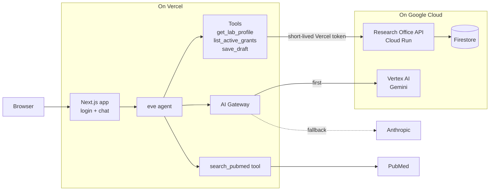

# GrantDesk

GrantDesk is a grant-writing agent for the Office of Research at Eastbrook University, a fictional university. Vercel runs the agent and the web app, and Google Cloud keeps the data.

## Try it

Demo: https://grantdesk-one.vercel.app/

Proposal (problem, architecture, rollout plan, success measures, risks, and platform feedback): https://grantdesk-one.vercel.app/proposal

| Demo email | Lab |
| --- | --- |
| `pi.protein@eastbrook.edu` | Protein Design Lab |
| `pi.neuro@eastbrook.edu` | Neuro Imaging Lab (Vertex AI only) |

Password: in the submission email.

Starter prompts, in order:

1. Summarize my lab's active grants and what's due next.
2. Find recent papers related to my lab's focus and draft a 250-word Significance section for my nearest-deadline grant, with PMID citations.
3. Save that Significance section to the Research Office.

The third prompt asks you to approve the save before anything is written.

## Architecture



- Anthropic and PubMed sit outside both clouds.
- The primary model is `google/gemini-3.7-flash`. The backup model is `anthropic/claude-sonnet-5.5`, tried on Vertex AI first, then on Anthropic directly (`agent/agent.ts`).
- The Neuro Imaging Lab has the `vertex-only` policy, so its requests stay on Vertex AI.
- Each API call carries a short-lived token that Vercel signs for this project. The API checks it against Vercel's published keys. There is no shared secret.

## What is real and what is fictional

Real:

- **Research Office API** on Google Cloud Run (`gcp/research-office-api/`). It accepts only tokens Vercel signs for this project.
- **Firestore** holds the lab, grant, and draft records. Saving a draft writes a real record.
- **PubMed** searches are live. Every citation is a real paper.
- **Vercel AI Gateway** sends every model request and tags it with the lab, policy, and environment.
- **eve** runs the agent, its four tools, and the approval step before a save.

Fictional:

- Eastbrook University
- The two labs and their research focus
- The three grants, their IDs, and deadlines
- The two users and their accounts

## Key decisions

- [0001 Augment, not replace](docs/decisions/0001-augment-not-replace.md): Vercel runs the agent and UI; Google Cloud keeps data, identity, and Vertex AI.
- [0002 Check Vercel's token in the API](docs/decisions/0002-vercel-oidc-at-the-api.md): no shared secret between Vercel and Google Cloud.
- [0003 One signed cookie for pages and the agent](docs/decisions/0003-one-cookie-for-pages-and-agent.md): the page guard and the agent check the same login, so they never disagree.

Every trade-off is marked with a `DECISION:` comment in the code. List them with `git grep -n "DECISION:"`.

## How AI behavior is checked

Four evals in `evals/` run the agent through scripted chats and check what it did. They use fake tool responses, which the agent allows only on a local dev server (`agent/channels/eve.ts`).

```sh
npx eve eval --strict
```

Last recorded run (Oct 27, 2026): 4 of 4 passed. Details and what each eval proves: [docs/eval-results.md](docs/eval-results.md).

## Release safety

Production uses Vercel rolling releases. A push to `main` sends the new build to 10% of traffic for 5 minutes, then 50% for 10 minutes, then 100%. The Oct 27, 2026 rehearsal confirmed the 10% stage, completed a release, and rolled production back to the previous build with `vercel rollback` in 3 seconds. Every command and its output: [docs/release-rehearsal.md](docs/release-rehearsal.md).

## Run it locally

You need Node 24.

```sh
git clone https://github.com/rgoldenbroit/grantdesk
cd grantdesk
npm install
npx eve link
vercel env pull .env.local
```

Then set your own local values in `.env.local`:

```sh
# 32+ characters, for example the output of: openssl rand -base64 32
SESSION_SECRET=
# Any password. You type it on the login page.
DEMO_PASSWORD=
```

Start the app, open the URL it prints, and sign in with a demo email and your `DEMO_PASSWORD`:

```sh
npm run dev
```

The local app calls the deployed Research Office API, so the API's `ALLOWED_ENVS` must include `development`.

### Gotchas

- Run `vercel login` before `npx eve link`. The link step needs it.
- `vercel env pull` writes placeholders for secret variables and doesn't say which ones. That is why you set `SESSION_SECRET` and `DEMO_PASSWORD` yourself.
- The Vercel token that `vercel env pull` writes to `.env.local` expires after about 12 hours. The API then rejects calls with an `"exp" claim` error. Pull again; `node scripts/oidc.mjs` prints when the token expires.

To deploy the API, copy `env.example.yaml` to `env.yaml` and fill in the `iss` and `aud` values that `node scripts/oidc.mjs` prints. Then run this from `gcp/research-office-api`:

```sh
gcloud run deploy research-office-api --source . --region us-east4 --allow-unauthenticated --env-vars-file env.yaml --max-instances 2
```

## Environment variables

[`.env.example`](.env.example) lists these with placeholder values. Set them in Vercel (Project → Settings → Environment Variables). `vercel env pull .env.local` copies them to your machine.

| Name | Environments | What it does |
| --- | --- | --- |
| `RESEARCH_OFFICE_API_URL` | All | Base URL of the Research Office API on Cloud Run |
| `NCBI_EMAIL` | All | Contact email sent with each PubMed request, as NCBI asks |
| `SESSION_SECRET` | All | Signs the login cookie. Must be 32+ characters |
| `DEMO_PASSWORD` | All | Password for both demo accounts |
| `DEV_LAB_ID` | Development only | Lab to use when there is no login, such as terminal chat with `npm run dev:eve`. Ignored on deployments |

The Cloud Run API reads its own settings from `gcp/research-office-api/env.yaml`. See `env.example.yaml` in that folder for the names.

## Platform feedback

What worked, what slowed the build down, and suggestions for Vercel: [FEEDBACK.md](FEEDBACK.md).
